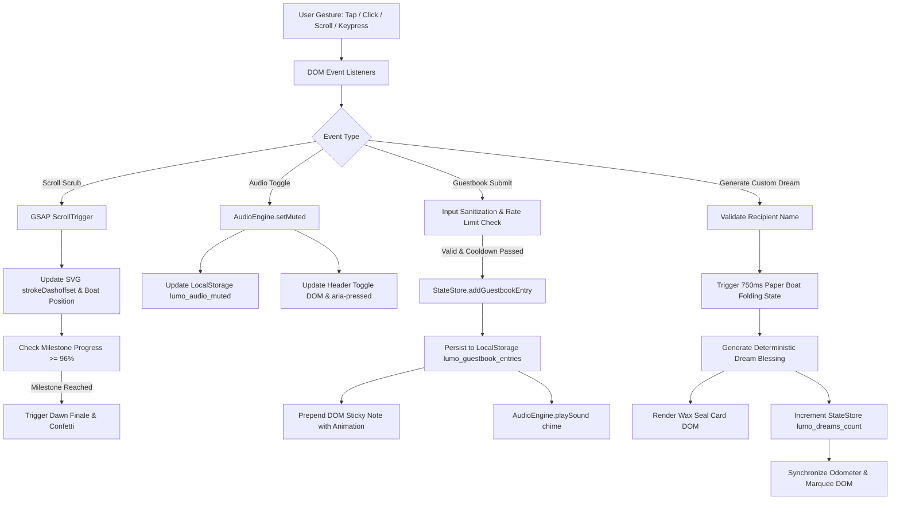

# Architecture Specification (ARCHITECTURE.md)

# 🌙 Lumo's Dream Delivery Service
**Document Version:** 1.0.0  
**Status:** Approved for Implementation / Architectural Source of Truth  
**Target Delivery Platform:** Modern Web (Desktop & Mobile Responsive, Zero-Build Static)  
**Author:** Senior Software Architect  

---

## 1. Executive Summary & Architectural Vision

**Lumo's Dream Delivery Service** is an interactive bedtime web experience designed to showcase an original character IP with the soul of early personal homepages and modern technical execution.

The architectural north star is **radical simplicity, zero operational overhead, and instant load time**. Rather than deploying heavy JavaScript frameworks, server runtimes, databases, or containerized microservices for an experience that is fundamentally a front-facing bedtime portfolio and interactive storybook, the system is engineered as a **Zero-Build, High-Performance Static Jamstack Architecture**.

```
+-------------------------------------------------------------------------------+
|                             CLIENT BROWSER (EDGE)                             |
|                                                                               |
|   +------------------+    +------------------+    +-----------------------+   |
|   |   Semantic DOM   |    |    Vanilla CSS   |    |   Modular ES6+ JS     |   |
|   |   HTML5 Canvas   |    |  Design System   |    |  Audio & State Store  |   |
|   +--------+---------+    +--------+---------+    +-----------+-----------+   |
|            ^                       ^                          ^               |
|            |                       |                          |               |
|   +--------+-----------------------+--------------------------+-----------+   |
|   |                       INTERNAL SERVICE ENGINES                        |   |
|   |  [Web Audio Engine]  [GSAP Scroll Controller]  [Origami Dream Engine] |   |
|   |  [Odometer Sync]     [Guestbook Controller]    [Companion Observer]   |   |
|   +--------------------------------+--------------------------------------+   |
|                                    |                                          |
|                                    v                                          |
|                   +---------------------------------+                         |
|                   |   Local Storage Persistence     |                         |
|                   |  (Preferences, Counts, Wishes)  |                         |
|                   +---------------------------------+                         |
+-------------------------------------------------------------------------------+
                                     |
                       HTTP / HTTPS (Static Delivery)
                                     v
+-------------------------------------------------------------------------------+
|                       GLOBAL EDGE CDN (Netlify / Vercel)                      |
|                                                                               |
|   index.html            styles.css             app.js           favicon.svg   |
+-------------------------------------------------------------------------------+
```

---

## 2. Recommended Tech Stack & Architectural Justification

| Layer | Selected Technology | Version / Spec | Architectural Justification |
| :--- | :--- | :--- | :--- |
| **Markup & Structure** | **HTML5 Semantic Elements** | Living Standard | Native `<header>`, `<main>`, `<section>`, `<article>`, `<dialog>`, and `<svg>`. Eliminates hydration delay, achieves instantaneous First Contentful Paint (FCP < 1.0s), and guarantees 100% SEO indexability. |
| **Styling & Design System**| **Vanilla CSS3** | Modern Spec | Utilizes CSS Custom Properties (tokens), CSS Grid, Flexbox, Container Queries, and `clamp()` fluid sizing. Eliminates CSS-in-JS runtime overhead and Tailwind build pipelines. |
| **Client Application Logic**| **Vanilla JavaScript (ES6+)**| ECMAScript 2022+ | Zero bundlers (no Webpack, Vite, or Rollup required). Fast native browser execution with modular architecture, strict scoping, and zero memory leaks. |
| **Vector Animation** | **GSAP & ScrollTrigger** | v3.12.5 (CDN) | Industry standard for high-performance 60fps SVG trajectory scrubbing, path length calculations, and timeline orchestration with GPU acceleration. |
| **Acoustic Engine** | **W3C Web Audio API** | Native Browser API | 100% procedural waveform synthesis (Sine, Triangle, Square). Requires 0 bytes of external audio downloads (`.mp3`/`.wav`), eliminating latency, network 404s, and licensing friction. |
| **Client Persistence** | **Browser `localStorage` API** | Web Storage API | Private, instant, serverless persistence for audio preferences, delivery counters, and guestbook entries. |
| **Hosting & Delivery** | **Static Edge CDN** | Netlify / GitHub Pages | Immutable static file delivery from global edge points with sub-50ms TTFB, HTTP/2, automated TLS certificates, and zero server maintenance costs. |

### Architectural Trade-Off Analysis
* **Why Not React / Next.js / Vue?**  
  A modern single-page storybook does not require a virtual DOM or server-side hydration. React would introduce ~140KB+ of framework JS, complex hydration lifecycles, and layout shifts during hydration, degrading performance for zero architectural gain.
* **Why Not Web Audio Audio Sprites / Audio Files?**  
  Network requests for audio files frequently fail on flaky mobile connections, incur latency, and trigger browser decoding pauses. Pure oscillator synthesis is instantaneous, zero-bandwidth, and generates rich, playful tones dynamically.

---

## 3. Frontend & Backend Architecture

### 3.1 Frontend Subsystem Architecture

The client logic is structured into encapsulated, single-responsibility software modules:

```
app.js (Master Orchestrator)
  ├── AudioEngine
  │     ├── initContext()
  │     ├── playSound(type) [click, modal_open, unseal, tickle, piano_key, dawn_chime]
  │     └── setMuted(boolean)
  ├── StateStore
  │     ├── getDreamsCount() / incrementDreamsCount()
  │     ├── getGuestbookEntries() / addGuestbookEntry()
  │     └── getAudioPreference() / saveAudioPreference()
  ├── RouteScrollManager
  │     ├── calculateSvgPath()
  │     ├── scrubBoatTrajectory(scrollProgress)
  │     └── triggerDawnFinale()
  ├── DreamWorkshopController
  │     ├── renderParcels()
  │     ├── openModal(parcelId)
  │     ├── trapFocus(modalElement)
  │     └── handleMarshmallowPianoKey(noteFrequency)
  ├── CustomDreamGenerator
  │     ├── validateInput(name)
  │     ├── runFoldingSequence()
  │     └── exportToClipboard()
  └── CompanionObserver
        ├── trackActiveSection()
        └── triggerReaction(wiggleType)
```

### 3.2 Backend Architecture: MVP vs. Future Scalability

#### MVP Architecture (Current Production Release)
* **Zero Backend Service:** The system functions autonomously on the client device.
* **Serverless Edge:** Asset delivery is handled by edge CDN cache nodes.
* **Security & Privacy by Default:** User data (guestbook notes, custom dreams) is stored locally on the client's device, ensuring zero GDPR/CCPA storage liabilities.

#### Future Scalability Path (v2.0 Architecture)
If global cross-device synchronization of the guestbook and worldwide odometer is authorized by stakeholders:
* **Edge Compute:** Cloudflare Workers or Vercel Edge Functions (lightweight serverless endpoints).
* **Distributed Database:** Cloudflare D1 (Serverless SQLite) or Supabase PostgreSQL.
* **Real-time WebSockets:** Durable Objects or Server-Sent Events (SSE) for live guestbook pins.

---

## 4. Data Flow Architecture

The application enforces a **Strict Unidirectional Event-Driven Data Flow**:



---

## 5. Repository & Folder Structure

A standardized, deterministic directory layout ensures maximum maintainability and zero build friction:

```
babyhack/
├── index.html              # Single source of truth for semantic markup & SVG definitions
├── styles.css              # Master design system stylesheet with tokens & responsive queries
├── app.js                  # Modular client application logic & audio synthesizer
├── favicon.svg             # Handcrafted SVG favicon (Lumo baby moon-cloud)
├── PRD.md                  # Product Requirements Document (Scope & Business Rules)
├── DESIGN.md               # Design System & UI/UX Specification
├── ARCHITECTURE.md         # Software Architecture & Engineering Specification
├── README.md               # Project documentation, running instructions, and credits
└── .git/                   # Version control repository
```

### File Responsibilities
* **`index.html`:** Contains semantic document structure, inline accessible SVG graphics (character, origami boat, parcels, starlight path), modal dialog templates, and accessible live regions.
* **`styles.css`:** Encapsulates the entire design system (CSS custom properties, typography scales, layout containers, responsive media queries, and `@media (prefers-reduced-motion)` rules).
* **`app.js`:** Pure ES6+ codebase containing audio synthesis algorithms, DOM event listeners, LocalStorage wrappers, and GSAP animation controller bindings.

---

## 6. Database & Persistence Layer

### 6.1 Storage Engine: Browser `localStorage`
For the MVP, persistence is delegated to the browser's persistent key-value store. This ensures instantaneous reads/writes (< 2ms) without network latency.

### 6.2 Data Schema Specifications

#### Schema 1: Audio Preference
* **Storage Key:** `lumo_audio_muted`
* **Data Type:** `DOMString` (`"true"` | `"false"`)
* **Default Value:** `"true"` (Adheres strictly to browser autoplay policies)
* **Access Pattern:** Read on initialization; written on toggle button click.

#### Schema 2: Worldwide Dreams Delivered Counter
* **Storage Key:** `lumo_dreams_count`
* **Data Type:** `DOMString` representation of an Integer
* **Default Value:** `"1204"`
* **Increment Triggers:**
  1. Cold page load (+1 per distinct session)
  2. Completion of the delivery route at Sunrise Cove (+1)
  3. Custom dream generation (+1)
  4. Parcel unsealed in DreamOS (+1)

#### Schema 3: Guestbook Repository
* **Storage Key:** `lumo_guestbook_entries`
* **Data Type:** Serialized JSON Array of `GuestbookEntry` records:
```typescript
interface GuestbookEntry {
  id: string;        // UUIDv4 or timestamp-based hash
  name: string;      // Trimmed string, max 30 characters
  wish: string;      // Trimmed string, max 140 characters
  timestamp: number; // Unix epoch millisecond
  avatarColor?: string; // Pastel badge color identifier
}
```

### 6.3 Defensive Storage Fallback Pattern
To guard against browsers with disabled cookies/storage, Safari Private Browsing quota errors, or iframe sandbox limitations, all storage operations must be wrapped in safe getter/setter functions:

```javascript
function safeGetItem(key, defaultValue) {
  try {
    const val = localStorage.getItem(key);
    return val !== null ? val : defaultValue;
  } catch (e) {
    console.warn(`LocalStorage read failed for ${key}:`, e);
    return defaultValue;
  }
}
```

---

## 7. Authentication, Authorization & Security Boundaries

### 7.1 Authentication & Authorization Model
* **Public Frictionless Access:** No user authentication (passwords, JWTs, OAuth) is implemented. This is a deliberate architectural decision to ensure zero friction for a relaxing bedtime site.
* **Role Separation:**
  * **Anonymous Consumer:** Full access to all interactive scenes, music instruments, and custom generators.
  * **Guestbook Poster:** Granted rights to write to local storage, subjected to automated validation and rate limiting.

### 7.2 Security Boundaries & Threat Modeling

| Threat Vector | Mitigation Architecture | Implementation Detail |
| :--- | :--- | :--- |
| **Cross-Site Scripting (XSS)** | Input Sanitization & Safe DOM Insertion | User inputs are stripped of `<script>`, `<iframe>`, and dangerous attributes. Content is written strictly via `.textContent` or safe sanitizers—never unsafe `innerHTML`. |
| **Spam & Flooding** | Client-Side Throttling | Enforces a mandatory **4000ms cooldown timer** between guestbook submissions. |
| **Profanity & Hostile Text** | Regex Replacement Engine | Converts vulgar or non-cozy phrases into wholesome emojis (`💛✨`) before rendering. |
| **Content Security Policy (CSP)**| Strict Origin Boundaries | Restricts external resources exclusively to trusted origins (`fonts.googleapis.com`, `fonts.gstatic.com`, `cdnjs.cloudflare.com`). |
| **Clickjacking / Framing** | HTTP Security Headers | Recommended header `X-Frame-Options: SAMEORIGIN` or CSP `frame-ancestors 'self'`. |

---

## 8. API Architecture & External Services

### 8.1 Browser Standard APIs Used

1. **W3C Web Audio API (`AudioContext`):**
   * Centralized audio graph with master gain node connected to dynamic oscillator voices.
   * Resumes automatically upon first user pointer down or keydown event.
2. **Navigator Clipboard API (`navigator.clipboard.writeText`):**
   * Used in the Custom Dream Generator to export formatted bedtime cards.
   * Fallback: Invisible DOM `<textarea>` element with `document.execCommand('copy')`.
3. **Intersection Observer API:**
   * Efficient, asynchronous tracking of active viewport sections for Lumo's companion reactions without scroll event lag.
4. **ResizeObserver API:**
   * Dynamic calculation of viewport dimensions for the live resolution badge.

### 8.2 External CDN Services

| External Service | Host Domain | Asset / Purpose | Reliability & Fallback Strategy |
| :--- | :--- | :--- | :--- |
| **Google Fonts** | `fonts.googleapis.com` | *Fredoka*, *Nunito*, *VT323* web fonts | Asynchronously loaded with `display=swap`. Fallback font stack: `system-ui, -apple-system, sans-serif, monospace`. |
| **Cloudflare CDNJS**| `cdnjs.cloudflare.com` | GSAP 3.12.5 & ScrollTrigger | Sub-resource Integrity (SRI) hashes enabled. Fallback: native CSS smooth scrolling. |

---

## 9. AI Architecture & Algorithmic Generators

### 9.1 Client-Side Deterministic Dream Generation Engine
To maintain zero runtime latency, zero API costs, and absolute reliability, dream generation utilizes a **Rule-Based Procedural Generator**:

```
[Input Recipient Name] ──> [Name Hash Algorithm] ──> [Seed Value]
                                                           │
               ┌───────────────────┬───────────────────────┴───────────────────────┐
               ▼                   ▼                                               ▼
      [Celestial Vessel]  [Enchanted Destination]                         [Bedtime Blessing]
      (e.g., Paper Boat)  (e.g., Sea of Whispering Stars)                 (e.g., Soft dreams of warm honey)
               │                   │                                               │
               └───────────────────┴───────────────────────┬───────────────────────┘
                                                           ▼
                                            [Structured Formatted Dream Card]
                                            [Wax Seal SVG + Copyable Plaintext]
```

### 9.2 Future Generative AI Extension (v2.0 Architectural Vision)
Should dynamic AI-generated bedtime stories be introduced:
* **Model:** Google Gemini 1.5 Flash via a secure edge proxy.
* **Latency Budget:** Streaming response with a typing animation directly onto the parchment parcel card.
* **Prompt Safety Filter:** Strict system instructions enforcing wholesome, gentle bedtime tones with zero nightmare triggers.

---

## 10. Environment Configuration & Operational Readiness

### 10.1 Environment Variables
Because this application is a client-side static bundle, it requires **zero runtime environment variables**. 

### 10.2 Cache-Busting & Asset Versioning Strategy
Static assets utilize explicit semantic query parameters in `index.html` to prevent stale client caches following deployments:
```html
<link rel="stylesheet" href="styles.css?v=2.6" />
<script src="app.js?v=2.6" defer></script>
```

### 10.3 Static Server Configuration (Netlify / Cloudflare / Nginx)

Recommended HTTP response headers:
```http
X-Content-Type-Options: nosniff
X-Frame-Options: SAMEORIGIN
X-XSS-Protection: 1; mode=block
Referrer-Policy: strict-origin-when-cross-origin
Permissions-Policy: geolocation=(), camera=(), microphone=()
Cache-Control: public, max-age=3600, must-revalidate
```

---

## 11. Error Handling & Resilience Architecture

The system implements defensive degradation across all critical paths:

```
[System Subsystem]            [Failure Mode]                  [Resilient Degradation]
────────────────────────────────────────────────────────────────────────────────────────────
Web Audio API           Browser blocks autoplay          Mute button displays 'Sound: OFF',
                                                        prompts gesture unlock without error.
Web Audio API           AudioContext creation fails      Application operates in silent mode;
                                                        UI animations remain 100% functional.
Clipboard API           Browser blocks permission        Falls back silently to execCommand('copy')
                                                        via temporary textarea.
LocalStorage            Private mode / Quota exceeded    State falls back to in-memory JS Object;
                                                        session continues without interruption.
GSAP CDN Library        CDN network timeout              Scroll navigation falls back to native
                                                        CSS smooth scrolling; path renders static.
Screen Orientation      Rapid mobile rotation            ResizeObserver recalculates path & bounds
                                                        without layout tearing.
```

---

## 12. Testing & Quality Assurance Architecture

### 12.1 Automated Testing Matrix

1. **Cross-Viewport Automated Regression Testing:**
   * Breakpoints tested: `360×780` (Compact Phone), `390×844` (Modern iPhone), `768×1024` (iPad), `1280×800` (Standard Laptop), `1440×900` (Large Desktop).
   * Metric: **Zero horizontal page scroll** (`scrollWidth === clientWidth`).
2. **Console Error Assertion:**
   * Browser execution must register **0 uncaught exceptions, 0 runtime errors, and 0 missing asset 404s**.
3. **Core Web Vitals & Lighthouse Targets:**
   * **Performance:** ≥ 95 (FCP < 1.0s, LCP < 1.5s, CLS = 0.00).
   * **Accessibility:** 100 (Full WCAG 2.1 AA validation).
   * **Best Practices:** 100 (Zero insecure dependencies, HTTPS only).
   * **SEO:** 100 (Semantic tags, meta description, structured metadata).

### 12.2 Audio Compliance Testing
* Cold page load must never emit audio prior to explicit user input.
* Sound toggle button must reflect accurate state in `aria-pressed` and visible label.

---

## 13. Deployment & CI/CD Pipeline

The deployment architecture is completely automated and declarative:

```
[Local Git Commit] ──> [Push to main Branch] ──> [GitHub / Netlify Webhook Trigger]
                                                              │
                                                              ▼
                                                   [Automated CI Check]
                                                   ├── HTML5 Validator
                                                   └── Lighthouse CI Audit
                                                              │
                                                              ▼
                                                   [Edge CDN Deployment]
                                                   ├── Global Static Distribution
                                                   ├── Automated SSL/TLS Renewal
                                                   └── Zero-Downtime Rollback
```

### Deployment Commands
* **Local Development Server:** `python3 -m http.server 8080` or `npx serve .`
* **Static Production Export:** Ready as-is; deploy directory root directly to hosting provider.

---

*End of Architecture Specification (ARCHITECTURE.md)*
