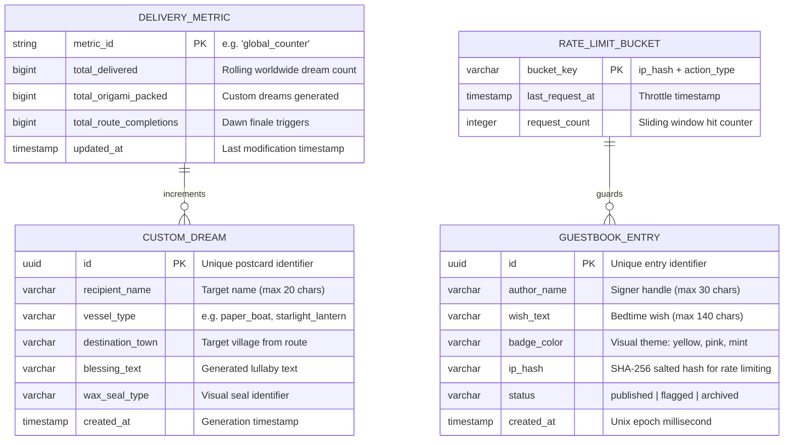

# Database & Persistence Specification (DATABASE.md)

# 🌙 Lumo's Dream Delivery Service
**Document Version:** 1.0.0  
**Status:** Approved for Implementation / Data Architecture Source of Truth  
**Target Delivery Platform:** Modern Web (Desktop & Mobile Responsive, Zero-Build Static)  
**Author:** Senior Database Architect & Backend Systems Engineer  

---

## 1. Overview & Data Philosophy

**Lumo's Dream Delivery Service** is an interactive bedtime sanctuary designed around user privacy, zero friction, and high operational reliability.

### 1.1 Data Design Principles
1. **Zero-PII & Privacy by Design:** The service never collects real names, email addresses, passwords, telephone numbers, tracking cookies, or payment data. User identity is limited to self-chosen bedtime nicknames.
2. **Dual-Tier Storage Strategy:**
   * **Tier 1 (MVP Local Client Storage):** Instantaneous client-side persistence using the browser's `localStorage` and `IndexedDB` APIs. Operates with zero network latency, zero hosting cost, and 100% offline support.
   * **Tier 2 (v2.0 Cloud Synchronized Database):** A lightweight serverless SQL database (Cloudflare D1 / Supabase PostgreSQL) designed for real-time worldwide guestbook sharing and global delivery counters.
3. **Write-Restrained & Read-Heavy:** Bedtime visitors browse, explore, and read far more than they write. Query patterns prioritize rapid index scans, automated caching, and small JSON payloads (< 20KB).

---

## 2. Database Technology Selection

| Dimension | Tier 1: Client Storage (MVP) | Tier 2: Cloud Sync (v2.0 Production) |
| :--- | :--- | :--- |
| **Technology** | **W3C `localStorage` / `IndexedDB`** | **Cloudflare D1 (Distributed SQLite) or PostgreSQL** |
| **Engine Type** | Key-Value / Object Store | Relational SQL (ACID compliant) |
| **Deployment** | Client Browser Sandbox | Global Anycast Edge Network |
| **Latency** | < 1ms (In-memory / Disk cache) | < 25ms (Edge data replicas) |
| **Auth Requirement** | Zero Authentication | Edge Worker Gateway with Tokenless Rate Limiting |
| **Backup / Recovery** | Browser Export / Backup string | Automated Nightly Snapshots & Point-in-Time Recovery |

---

## 3. Entity Relationship (ER) Diagram



---

## 4. Tables, Schema & Column Definitions

### 4.1 Table: `guestbook_entries`
Stores community bedtime wishes displayed on the public sticky-note cloud board.

```sql
CREATE TABLE guestbook_entries (
    id            UUID PRIMARY KEY DEFAULT gen_random_uuid(),
    author_name   VARCHAR(30) NOT NULL,
    wish_text     VARCHAR(140) NOT NULL,
    badge_color   VARCHAR(20) NOT NULL DEFAULT 'yellow',
    ip_hash       VARCHAR(64) NOT NULL,
    status        VARCHAR(20) NOT NULL DEFAULT 'published',
    created_at    TIMESTAMPTZ NOT NULL DEFAULT CURRENT_TIMESTAMP,

    -- Constraints
    CONSTRAINT chk_author_name_length CHECK (LENGTH(TRIM(author_name)) >= 1),
    CONSTRAINT chk_wish_text_length   CHECK (LENGTH(TRIM(wish_text)) >= 1),
    CONSTRAINT chk_badge_color_enum   CHECK (badge_color IN ('yellow', 'pink', 'mint', 'peach')),
    CONSTRAINT chk_entry_status_enum  CHECK (status IN ('published', 'flagged', 'archived'))
);
```

### 4.2 Table: `delivery_metrics`
Maintains atomic singleton counters for the mechanical odometer and scrolling marquee.

```sql
CREATE TABLE delivery_metrics (
    metric_id               VARCHAR(50) PRIMARY KEY,
    total_delivered         BIGINT NOT NULL DEFAULT 1204,
    total_origami_packed    BIGINT NOT NULL DEFAULT 0,
    total_route_completions BIGINT NOT NULL DEFAULT 0,
    updated_at              TIMESTAMPTZ NOT NULL DEFAULT CURRENT_TIMESTAMP,

    CONSTRAINT chk_metric_positive CHECK (total_delivered >= 1204)
);
```

### 4.3 Table: `custom_dreams` (Optional Cloud Keepsakes)
Stores personalized folded paper-boat dreams if users generate sharable URLs.

```sql
CREATE TABLE custom_dreams (
    id               UUID PRIMARY KEY DEFAULT gen_random_uuid(),
    recipient_name   VARCHAR(20) NOT NULL,
    vessel_type      VARCHAR(50) NOT NULL DEFAULT 'paper_boat',
    destination_town VARCHAR(50) NOT NULL DEFAULT 'Sunrise Cove',
    blessing_text    VARCHAR(255) NOT NULL,
    wax_seal_type    VARCHAR(30) NOT NULL DEFAULT 'gold_crescent',
    created_at       TIMESTAMPTZ NOT NULL DEFAULT CURRENT_TIMESTAMP,

    CONSTRAINT chk_recipient_length CHECK (LENGTH(TRIM(recipient_name)) >= 1)
);
```

### 4.4 Table: `rate_limit_buckets`
Ephemeral edge cache for client throttling without IP exposure.

```sql
CREATE TABLE rate_limit_buckets (
    bucket_key      VARCHAR(64) PRIMARY KEY, -- SHA-256(client_ip + salt + action)
    last_request_at TIMESTAMPTZ NOT NULL,
    request_count   INTEGER NOT NULL DEFAULT 1
);
```

---

## 5. Indexes & Query Performance Optimization

Indexes are designed strictly to accelerate the top user queries while keeping write overhead near zero:

### 5.1 Query Pattern 1: Fetch Latest Published Guestbook Feed
* **Query:** `SELECT author_name, wish_text, badge_color, created_at FROM guestbook_entries WHERE status = 'published' ORDER BY created_at DESC LIMIT 50;`
* **Index:**
```sql
CREATE INDEX idx_guestbook_feed 
ON guestbook_entries (status, created_at DESC);
```
* **Performance Impact:** Index-only scan; response generated in < 5ms without table heap lookups.

### 5.2 Query Pattern 2: Rate Limit & Abuse Check
* **Query:** `SELECT COUNT(*) FROM guestbook_entries WHERE ip_hash = $1 AND created_at > (NOW() - INTERVAL '4 seconds');`
* **Index:**
```sql
CREATE INDEX idx_guestbook_rate_limit 
ON guestbook_entries (ip_hash, created_at DESC);
```

### 5.3 Query Pattern 3: Atomic Metric Read & Increment
* **Query:** `UPDATE delivery_metrics SET total_delivered = total_delivered + 1, updated_at = NOW() WHERE metric_id = 'global_counter' RETURNING total_delivered;`
* **Performance Impact:** Single-row primary key write locked for < 1ms.

---

## 6. Ownership, Authorization & Row-Level Security (RLS)

If deployed on a cloud PostgreSQL database (e.g., Supabase / Neon), **Row-Level Security (RLS)** guarantees absolute boundary control:

```sql
-- Enable RLS on public tables
ALTER TABLE guestbook_entries ENABLE ROW LEVEL SECURITY;
ALTER TABLE delivery_metrics ENABLE ROW LEVEL SECURITY;
ALTER TABLE custom_dreams ENABLE ROW LEVEL SECURITY;

-- Policy 1: Anyone (Anonymous Public) can view published guestbook wishes
CREATE POLICY p_guestbook_public_select 
ON guestbook_entries 
FOR SELECT 
TO anon 
USING (status = 'published');

-- Policy 2: Public can insert a new guestbook wish (Status forced to 'published')
CREATE POLICY p_guestbook_public_insert 
ON guestbook_entries 
FOR INSERT 
TO anon 
WITH CHECK (
    status = 'published' 
    AND LENGTH(TRIM(author_name)) BETWEEN 1 AND 30 
    AND LENGTH(TRIM(wish_text)) BETWEEN 1 AND 140
);

-- Policy 3: Prevent all public UPDATE or DELETE operations on guestbook
CREATE POLICY p_guestbook_public_modify_deny 
ON guestbook_entries 
FOR UPDATE 
TO anon 
USING (false);

CREATE POLICY p_guestbook_public_delete_deny 
ON guestbook_entries 
FOR DELETE 
TO anon 
USING (false);

-- Policy 4: Public can read worldwide delivery metrics
CREATE POLICY p_metrics_public_select 
ON delivery_metrics 
FOR SELECT 
TO anon 
USING (true);
```

---

## 7. Sensitive Data Handling & Anonymization

### 7.1 Cryptographic IP Hashing Pattern
To enforce a 4-second submission cooldown and prevent denial-of-service spam **without storing identifiable personal data**:

```
Client IP Address (e.g. 198.51.100.42)
             │
             ▼
   + Secret Salt (Rotated periodically: e.g. "lumo-starlight-salt-2026")
             │
             ▼
       SHA-256 Hashing Algorithm
             │
             ▼
Resulting Hash: "e3b0c44298fc1c149afbf4c8996fb92427ae41e4649b934ca495991b7852b855"
```
* **Irreversibility:** The raw IP cannot be reversed or retrieved from the database.
* **Compliance:** Fully compliant with GDPR Article 4 (pseudonymization) and CCPA standards.

---

## 8. Migration & Seed Strategy

### 8.1 Migration Script: `0001_initial_schema.sql`
All schema definitions, constraints, and indexes defined in Sections 4 and 5 are packaged into versioned, idempotent migrations.

### 8.2 Seed Data: Wholesome Initial Records
The database is pre-seeded with canon bedtime notes to ensure new visitors are greeted by a warm, active community board:

```sql
-- Seed Initial Singleton Metrics
INSERT INTO delivery_metrics (metric_id, total_delivered, total_origami_packed, total_route_completions)
VALUES ('global_counter', 1204, 86, 142)
ON CONFLICT (metric_id) DO NOTHING;

-- Seed Canon Wholesome Guestbook Notes
INSERT INTO guestbook_entries (author_name, wish_text, badge_color, ip_hash, status, created_at)
VALUES
('Star-Gazer Maya', 'May tonight bring deep rest to all restless thinkers. ✨', 'yellow', 'system_seed_hash', 'published', NOW() - INTERVAL '4 hours'),
('Grandma Nora', 'Soft blankets and sweet warm dreams to my little ones. 💛', 'pink', 'system_seed_hash', 'published', NOW() - INTERVAL '3 hours'),
('Sleepy Leo', 'Sending a flying pancake dream to anyone waking up early! 🥞', 'mint', 'system_seed_hash', 'published', NOW() - INTERVAL '2 hours'),
('Little Pip', 'Goodnight moon! Goodnight Lumo! 🌙', 'peach', 'system_seed_hash', 'published', NOW() - INTERVAL '1 hour'),
('Captain Cloud', 'Smooth sailing through the sea of stars tonight. ⛵', 'yellow', 'system_seed_hash', 'published', NOW() - INTERVAL '20 minutes')
ON CONFLICT DO NOTHING;
```

---

## 9. Backup, Disaster Recovery & High Availability

| Resilience Factor | Tier 1 (Client LocalStorage) | Tier 2 (Cloud Database D1 / Postgres) |
| :--- | :--- | :--- |
| **High Availability** | 100% available offline on client device. | 99.99% edge availability across multi-region edge replicas. |
| **Automated Backups** | Client-driven "Export Wishes" JSON file download. | Automated daily snapshots retained for 30 rolling days. |
| **Recovery Point Objective (RPO)** | Session-bound. | < 1 minute via transaction log replication. |
| **Recovery Time Objective (RTO)** | 0 seconds. | < 5 minutes automated failover to replica. |
| **Disaster Recovery Playbook** | In-memory fallback if storage quota is exceeded. | Restore latest snapshot via edge CLI in a single command. |

---

*End of Database & Persistence Specification (DATABASE.md)*
