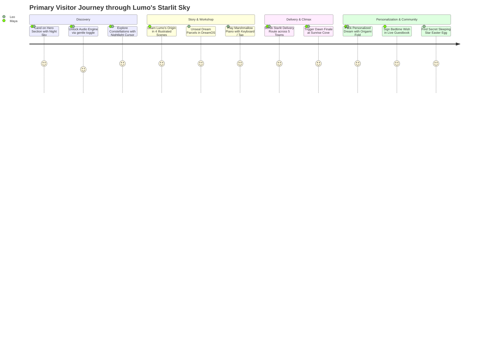

# Product Requirements Document (PRD)

# 🌙 Lumo's Dream Delivery Service
**Document Version:** 1.0.0  
**Status:** Approved for Implementation / Source of Truth  
**Target Delivery Platform:** Modern Web (Desktop & Mobile Responsive, Zero-Build Static)  
**Author:** Senior Product Manager & Software Architect  

---

## 1. Executive Summary, Problem & Value Proposition

### 1.1 Problem Statement
Modern digital web experiences have become increasingly homogeneous, sterile, and anxiety-inducing. Mobile and desktop browsing during late evening hours is frequently dominated by algorithmic infinite feeds, intrusive ads, cookie banners, and overstimulating interfaces that exacerbate nighttime restlessness. Furthermore, the playful whimsy, tactile delight, and handmade soul of the early web (late 90s/early 2000s personal homepages with guestbooks, pixel badges, mechanical counters, and hidden secrets) has been largely replaced by corporate design systems.

### 1.2 Value Proposition
**Lumo's Dream Delivery Service** is a cozy, interactive bedtime sanctuary starring an original character—**Lumo the Baby Moon-Cloud**. It delivers a tranquil, story-driven digital experience combining nostalgic early-web charm (pixel badges, rolling mechanical hit counters, sticky-note guestbook, retro window frames) with modern technical excellence (fluid SVG scroll scrubbing, procedural Web Audio synthesis, accessible modal dialogs, and dynamic day/night atmospheric transitions).

### 1.3 Target Users
1. **Bedtime Unwinders & Stargazers:** Users seeking a calm, cozy, low-stimulation visual and acoustic experience to decompress before sleep.
2. **Indie Web & Nostalgia Enthusiasts:** Creative web designers, digital crafters, and retro web fans who value craft, Easter eggs, and personal web artifacts.
3. **Hackathon Evaluators & Portfolio Reviewers:** Judges evaluating original character IP, creative frontend engineering, accessibility, performance, and story-driven interaction under 150 words per section.

---

## 2. Core User Personas, Journeys & User Stories

### 2.1 Personas
* **Maya (The Sleepy Explorer):** Browsing on a smartphone at 11:30 PM. Desires calming micro-interactions, soft soothing chimes, zero high-stress prompts, and fluid mobile ergonomics.
* **Leo (The Nostalgic Crafter):** Exploring on a desktop browser. Loves uncovering hidden secrets, playing retro instruments, and inspecting semantic markup and early-web Easter eggs.

### 2.2 Core User Journey



### 2.3 User Stories
* **US-01 (Atmospheric Exploration):** *As a visitor,* I want to scroll through a sky gradient that shifts naturally from dusk to midnight to dawn, *so that* I experience an organic sense of nighttime passage.
* **US-02 (Interactive Delivery Route):** *As a visitor,* I want to scrub Lumo's paper boat along a curved starlight path and see villages light up on arrival, *so that* I feel actively involved in tucking in the world.
* **US-03 (Playable Sound):** *As a visitor,* I want to play soothing pentatonic lullaby notes on squishy marshmallow keys, *so that* I can create gentle music without jarring or discordant sounds.
* **US-04 (Personalized Dream Origami):** *As a visitor,* I want to type my name and receive a custom folded bedtime dream parcel, *so that* I have a personal bedtime keepsake to copy or share.
* **US-05 (Cozy Community Wish):** *As a visitor,* I want to pin a bedtime wish to the cloud board and read others' notes, *so that* I feel connected to a warm, gentle community.
* **US-06 (Audio Accessibility):** *As a visitor,* I want complete control over sound with a single accessible toggle, *so that* audio never plays unexpectedly or overstimulates me.

---

## 3. Roles and Permissions

Because Lumo's Dream Delivery Service is designed as an accessible, friction-free client-side sanctuary, there is no barrier to entry (no accounts, passwords, or authentication hurdles).

| Role | Scope & Privileges | Restrictions & Guardrails |
| :--- | :--- | :--- |
| **Anonymous Visitor (Default)** | Full read and interactive access across all 6 sections: play piano, scrub delivery map, trigger dawn finale, generate custom dream cards, copy dream text, and toggle audio. | Cannot bypass clientside rate limits (4-second guestbook throttle); cannot submit HTML/script tags (sanitized via XSS filter). |
| **Guestbook Contributor** | Can submit nickname (max 30 chars) and bedtime wish (max 140 chars) to the public sticky board. | Enforced 4-second submission cooldown; automated profanity/non-cozy word filter replacing negative terms with wholesome emojis. |
| **Host Character (Lumo)** | Autonomous UI companion rendering contextual emoji thoughts and responsive squeak/wiggle reactions. | System-driven only; responds dynamically to user scroll offset and direct tap/click interactions. |
| **Administrator / Maintainer** | Repository-level owner updating code, lore, and styling assets. | Static build environment; no serverside database admin portal required. |

---

## 4. Product Architecture & System Feature Matrix

### 4.1 Architectural Principles
* **Zero Build Step:** Native HTML5, Vanilla CSS3, Vanilla ES6+ JavaScript. No bundling, transpilation, or heavy frameworks required to run or deploy.
* **Lightweight Dependencies:** Third-party runtime libraries restricted exclusively to trusted CDN sources:
  * GreenSock GSAP 3.12.5 & ScrollTrigger (for 60fps SVG timeline scrubbing).
  * Google Fonts (*Fredoka*, *Nunito*, *VT323*).
* **Pure Procedural Audio:** 100% Web Audio API oscillator synthesis; zero external `.mp3`/`.wav` assets to eliminate load latency and network failures.
* **Mobile-First & Fluid Layout:** CSS Grid, Flexbox, Container Queries, and responsive clamping (`clamp()`) ensuring zero horizontal overflow at 360px, 390px, 768px, and 1280px+.
* **Content Restraint:** Every major section must contain **≤ 150 words** of readable copy.

### 4.2 System Feature Matrix

| Module ID | Feature Name | Description | Priority |
| :--- | :--- | :--- | :--- |
| **MOD-01** | **Top Header & Sound Control** | Sticky retro navbar with live screen badge, brand mark, and accessible audio toggle. | P0 (Must Have) |
| **MOD-02** | **Hero & Character Showcase** | Original baby character SVG with floating animation, nightlight glow, and character card. | P0 (Must Have) |
| **MOD-03** | **Nightlight Flashlight Layer** | Radial mask following pointer/touch revealing secret constellations in the dark sky. | P0 (Must Have) |
| **MOD-04** | **Origin Storybook** | 4-scene illustrated narrative detailing Lumo's birth, search, and purpose. | P0 (Must Have) |
| **MOD-05** | **DreamOS Workshop** | Retro window chrome with 4 dream parcels and interactive nightlight dimmer dial. | P0 (Must Have) |
| **MOD-06** | **Playable Marshmallow Piano** | 8-key pentatonic instrument inside Parcel #03 with keyboard (`A-K`) and touch support. | P0 (Must Have) |
| **MOD-07** | **Animated Parcel Scenes** | Looping SVG animations for Parcel #01 (Pancake) and Parcel #02 (Underwater Library). | P1 (Should Have) |
| **MOD-08** | **Starlit Delivery Route** | Scroll-scrubbed SVG trajectory with 5 village nodes lighting up progressively. | P0 (Must Have) |
| **MOD-09** | **The Dawn Finale** | Milestone trigger at 100% route: sunrise sky, lighthouse beam, confetti, and sleepy card. | P0 (Must Have) |
| **MOD-10** | **Deliver a Dream to Me** | Name input generator with folding paper-boat animation, wax seal, and clipboard copy. | P0 (Must Have) |
| **MOD-11** | **Mechanical Odometer** | Rolling 6-digit counter synchronized across header marquee and dream deliveries. | P0 (Must Have) |
| **MOD-12** | **Live Guestbook Wall** | Sanitized, rate-limited sticky-note board with `localStorage` persistence. | P0 (Must Have) |
| **MOD-13** | **Lumo Floating Companion** | Peeking avatar reacting to viewport sections with contextual emoji thought bubbles. | P1 (Should Have) |
| **MOD-14** | **Early-Web Webring** | Nostalgic navigation panel with random dream teleportation and section jump toasts. | P1 (Should Have) |
| **MOD-15** | **Secret Easter Eggs** | Hidden Sleeping Star lullaby sleep mode and Logo triple-click / Konami certification. | P1 (Should Have) |

---

## 5. Detailed Functional Requirements

### 5.1 MOD-01: Header & Audio Engine
* **FR-01.1:** The header must remain fixed at the viewport top (`z-index: 900`).
* **FR-01.2:** Audio starts in `Sound: OFF 🔇` state on cold load.
* **FR-01.3:** First user interaction unlocks the `AudioContext`.
* **FR-01.4:** Audio button updates `aria-pressed`, label text, and persists state in `localStorage('lumo_audio_muted')`.
* **FR-01.5:** Dynamic resolution badge reflects live `window.innerWidth × window.innerHeight` and updates on window resize/orientation change.

### 5.2 MOD-02 & MOD-03: Character Showcase & Nightlight Layer
* **FR-02.1:** Lumo SVG must be 100% original: round cloud silhouette, golden crescent curl, rosy cheeks, stubby waving arms, and central glowing nightlight belly.
* **FR-02.2:** Nightlight mask uses CSS radial-gradient (`-webkit-mask-image`).
* **FR-02.3:** Tracking coordinates update on mouse movement (desktop) and touch move/drag (mobile).
* **FR-02.4:** Hidden items (*Teapot of Dreams*, *Moon Bunny*, *Snoozing Cub*) have `pointer-events: none` and `z-index: 1`, preventing interference with interactive buttons.
* **FR-02.5:** Idle hint pill (`#idleHint`) triggers after 30s of user inactivity, displays dismiss button `✕`, and auto-dismisses after 6s.

### 5.3 MOD-05 & MOD-06: Dream Workshop & Marshmallow Piano
* **FR-05.1:** Grid renders 4 parcel cards:
  1. *The Flying Pancake Dream* (`#01`)
  2. *The Underwater Library Dream* (`#02`)
  3. *The Marshmallow Piano Dream* (`#03`)
  4. *The Cloud Trampoline Dream* (`#04`)
* **FR-05.2:** Nightlight dial slider (`#glowSlider`) adjusts Lumo's belly opacity in real-time from 20% to 100%.
* **FR-06.1:** When Parcel #03 is opened, `#modalInteractiveArea` renders 8 squishy keys:
  * `A` (C5 - 523.25 Hz)
  * `S` (D5 - 587.33 Hz)
  * `D` (E5 - 659.25 Hz)
  * `F` (G5 - 783.99 Hz)
  * `G` (A5 - 880.00 Hz)
  * `H` (C6 - 1046.50 Hz)
  * `J` (D6 - 1174.66 Hz)
  * `K` (E6 - 1318.51 Hz)
* **FR-06.2:** Keys respond to mouse click, touch tap, and physical keyboard keys `A, S, D, F, G, H, J, K`.
* **FR-06.3:** Modal enforces focus trapping (`Tab`/`Shift+Tab`) and closes on `Escape` key or backdrop click. Focus returns to the opening parcel card upon closing.

### 5.4 MOD-08 & MOD-09: Delivery Route & The Dawn Finale
* **FR-08.1:** SVG path length is dynamically calculated using `.getTotalLength()`.
* **FR-08.2:** Scroll position scrubs `strokeDashoffset` and computes traveler boat position and tangent angle via `.getPointAtLength()`.
* **FR-08.3:** Towns activate progressively:
  1. *Slumberton* (0% progress)
  2. *Starfall Glade* (26% progress)
  3. *Pillow Peak* (52% progress)
  4. *Dewdrop Hollow* (76% progress)
  5. *Sunrise Cove* (96-100% progress)
* **FR-09.1:** At ≥ 96% progress, triggers `triggerDawnFinale()`:
  * Body class adds `.dawn-sunrise-mode` transitioning background to gold/peach/pink.
  * Lighthouse beacon pulses and towns illuminate.
  * Generates 45 star confetti particles with randomized drift velocities.
  * Increments worldwide delivery counter by +1.
  * Plays wind-chime celebration chord.
  * Renders `#dawnFinaleCard` with curled sleeping Lumo and replay button.

### 5.5 MOD-10: "Deliver a Dream to Me" Custom Bedtime Origami
* **FR-10.1:** Accepts recipient name (max 20 characters).
* **FR-10.2:** Sanitizes input by stripping `<`, `>`, `'`, `"`, `/`, `\`, `&`.
* **FR-10.3:** Displays 750ms paper-boat folding animation (`#boatFoldingLoader`).
* **FR-10.4:** Renders personalized dream parcel with bouncing wax seal (`★ LUMO'S WAX SEAL ★`).
* **FR-10.5:** Provides *"Copy Dream 📋"* button supporting Clipboard API with `document.execCommand` fallback and starlight toast notification.
* **FR-10.6:** Automatically increments mechanical odometer count.

### 5.6 MOD-12: Live Guestbook Wall
* **FR-12.1:** Collects signer nickname (max 30 chars) and bedtime wish (max 140 chars).
* **FR-12.2:** Real-time character counter indicates remaining characters.
* **FR-12.3:** Enforces 4-second rate limiting between submissions.
* **FR-12.4:** Sanitizes text against XSS injection and filters non-cozy words into wholesome emojis (`💛✨`).
* **FR-12.5:** Pre-seeds 5 default entries on first visit; persists user submissions in `localStorage('lumo_guestbook_entries')`.

### 5.7 MOD-13: Floating Lumo Companion
* **FR-13.1:** Fixed avatar in bottom-right corner (`z-index: 850`).
* **FR-13.2:** `IntersectionObserver` tracks active section and displays contextual emoji:
  * Hero: `💤`
  * About: `💛`
  * Story: `✨`
  * Work: `🥞`
  * Map: `⛵`
  * Footer: `📝`
* **FR-13.3:** Tapping/clicking Lumo triggers squish-wiggle animation, audio giggle, and temporary speech bubble (`"🥰 Hi!"`, `"✨ Giggle!"`, `"💛 Hehe!"`, `"🌙 Boop!"`).
* **FR-13.4:** Automatically hidden on screens narrower than 380px (`@media (max-width: 380px)`).

---

## 6. Non-Functional Requirements (NFRs)

### 6.1 Performance
* **NFR-01 (Load Speed):** First Contentful Paint (FCP) < 1.0s on standard 4G mobile networks.
* **NFR-02 (Frame Rate):** Animation rendering (GSAP scroll scrub, SVG boat movement, sparkle cursor pool) must maintain a stable 60fps.
* **NFR-03 (Zero External Audio Assets):** Zero external `.mp3`/`.wav` network requests. Pure Web Audio synthesis ensures instant sound ready in 0ms.
* **NFR-04 (Lightweight Payload):** Total assets (HTML, CSS, JS, inline SVG, fonts) must remain < 150KB gzip.

### 6.2 Accessibility & Usability
* **NFR-05 (WCAG 2.1 AA Compliance):** All readable copy meets or exceeds 4.5:1 contrast against dark and dawn backgrounds (footer and credit text verified at ≥ 5:1).
* **NFR-06 (Reduced Motion):** Complete adherence to `@media (prefers-reduced-motion: reduce)`: pauses continuous floating loops, stops confetti drift, and substitutes rapid transforms with subtle cross-fades.
* **NFR-07 (Focus Entrapment & Screen Readers):** Modals utilize `<dialog>` semantics with keyboard focus isolation, `Escape` key listeners, and descriptive `aria-label`/`aria-live` attributes.

### 6.3 Responsive Architecture
* **NFR-08 (Zero Horizontal Overflow):** Strict `overflow-x: hidden` enforcement across all standard viewports: 360px, 390px, 480px, 768px, 1024px, 1280px, and 1440px+.

---

## 7. Pages, Screens & Information Architecture

The application is structured as a continuous single-page journey with progressive disclosure:

```
[Fixed Top Header & Ticker]
  ├── Brand Logo (Triple-click secret)
  ├── Live Resolution Badge (Chaos Mode)
  ├── Audio Toggle Button (Mute / Unmute)
  └── Scrolling Delivery Marquee

[Section 1: Hero (#hero)]
  ├── Section Tag & Display Heading (≤ 66 words)
  ├── Handcrafted SVG Lumo (Tickle reaction & eye tracking)
  └── Call to Action Buttons ("Explore The Route", "Unseal Dreams")

[Section 2: About & Character Sheet (#about)]
  ├── 5-Point Trading Card (Name, Nature, Mission, Story, Tagline)
  └── Lore Notebook & Characteristic Badges (≤ 127 words)

[Section 3: Storybook Origin (#story)]
  ├── 4-Scene Horizontal Grid (≤ 123 words)
  │    ├── Scene 01: The Lost Lullaby
  │    ├── Scene 02: The Lonely First Night
  │    ├── Scene 03: Discovering the Dreams
  │    └── Scene 04: The First Delivery

[Section 4: Dream Workshop (#work)]
  ├── Retro Window Frame (DreamOS v2.4)
  ├── 4 Parcel Cards Grid (≤ 134 words)
  ├── Nightlight Glow Dimmer Dial Gadget
  └── Accessible Modal Dialog (#dreamModal)
       ├── Pancake Scene (Looping SVG)
       ├── Underwater Library Scene (Looping SVG)
       ├── Marshmallow Piano (8 Squishy Keys)
       └── Cloud Trampoline Scene

[Section 5: Delivery Route & Dawn Finale (#map)]
  ├── Route Stats Bar (Courier Vessel, Next Stop, Progress %)
  ├── Interactive SVG Starlight Path with 5 Village Nodes (≤ 96 words)
  └── The Dawn Finale Celebration Card (Sunrise transition & Replay)

[Section 6: Community & Footer (#footer)]
  ├── Mechanical Hit Counter Odometer (6 rolling digits)
  ├── "Deliver a Dream to Me" Custom Dream Generator Card
  ├── Live Sticky-Note Guestbook (Submission form & pin board)
  ├── Nostalgic Dreamland Webring & Badges Strip
  └── Honest Credits & AI Attribution (≤ 124 words)

[Fixed Peeking Companion (#lumoCompanion)]
  └── Bottom-Right Lumo with Section-Aware Thought Bubble
```

---

## 8. Data Requirements & Schemas

The application relies entirely on browser-local storage (`localStorage`) for privacy, speed, and zero server maintenance.

### 8.1 LocalStorage Keys & Data Models

#### 1. Audio Preference
* **Key:** `lumo_audio_muted`
* **Type:** `String` (`"true"` | `"false"`)
* **Default:** `"true"` on first visit.

#### 2. Worldwide Dreams Delivered Counter
* **Key:** `lumo_dreams_count`
* **Type:** `Integer` (stored as string)
* **Default:** `1204` (increments by +1 on each session visit, parcel ship, custom dream pack, or route completion).

#### 3. Live Guestbook Entries
* **Key:** `lumo_guestbook_entries`
* **Type:** `JSON Array` of Objects
* **Schema:**
```typescript
interface GuestbookEntry {
  name: string;      // Max 30 chars, HTML-escaped, profanity-filtered
  wish: string;      // Max 140 chars, HTML-escaped, profanity-filtered
  timestamp?: number;// Unix epoch millisecond
}
```

---

## 9. System Integrations

| Integration Type | Technology / API | Purpose | Fallback / Redundancy |
| :--- | :--- | :--- | :--- |
| **Audio Synthesis** | W3C Web Audio API (`AudioContext`) | Real-time procedural tone generation for chimes, piano, tickle giggles, and wind chimes. | Silent mode if `AudioContext` is unsupported or disabled by browser policy. |
| **Animation Engine** | GSAP 3.12.5 & ScrollTrigger (CDN) | Path length measurement and scroll scrub synchronization along the delivery route. | Native CSS smooth scrolling and basic visibility toggles if CDN fails. |
| **Typography** | Google Fonts API | Early-web aesthetic via *Fredoka*, *Nunito*, and *VT323* retro bitmap fonts. | System font stack (`system-ui, -apple-system, sans-serif, monospace`). |
| **Clipboard System** | Browser Navigator Clipboard API | Instant copying of custom folded dream cards. | Invisible `document.execCommand('copy')` textarea fallback. |
| **Viewport Observers** | `IntersectionObserver` & `ResizeObserver` | Tracks active sections for Lumo companion thoughts and updates live resolution badge. | Passive `window.onscroll` and `window.onresize` throttled handlers. |
| **Community Webring** | Standard Hyperlink & Modal Exchange | Nostalgic early-web webring navigation between friendly bedtime sites. | Self-contained loop back to hero anchor `#hero`. |

---

## 10. Loading, Empty and Error States

| Context | State Type | Expected Behavior |
| :--- | :--- | :--- |
| **Audio Engine** | Initial / Cold State | Audio is paused; button displays `"Sound: OFF 🔇"` with subtle pulse nudge. Unlocks on explicit user gesture. |
| **Custom Dream Generator** | Loading State | Displays 750ms paper-boat folding animation with pulsing text: *"Folding paper boat into starlight dreams..."* |
| **Custom Dream Generator** | Empty Input State | Disables submit button until name length is between 1 and 20 valid characters. |
| **Clipboard Copy** | Success State | Displays `"Copied to starlight clipboard! ✨"` toast and plays high-register bell chime. |
| **Clipboard Copy** | Error / Blocked State | Gracefully falls back to invisible textarea selection and `document.execCommand('copy')`. |
| **Guestbook Form** | Rate Limited (< 4s) | Displays alert: *"Patience, sleepy friend! Please wait a moment before sending another dream wish. ✨"* |
| **Guestbook Form** | Empty Input State | Form validation blocks submit; highlights empty input with friendly focus glow. |
| **Guestbook Wall** | Cold Storage / Empty | Automatically injects 5 wholesome pre-seeded entries (*Star-Gazer Maya*, *Grandma Nora*, *Sleepy Leo*, etc.). |
| **Nightlight Mask** | Touch Device / Unsupported | Radial gradient flashlight gracefully falls back to soft 45% starlight opacity; all constellations remain readable. |

---

## 11. MVP Scope, Out-of-Scope & Success Criteria

### 11.1 MVP Scope (Included in Current Release)
* Complete single-page portfolio with all 6 required sections under 150 words each.
* Original baby character illustrations, animations, and lore.
* Fully interactive delivery map with scrubbed SVG boat and dawn finale.
* Interactive 8-key marshmallow piano with Web Audio synthesis and parcel looping SVGs.
* "Deliver a Dream to Me" personalized dream generator with wax seal.
* Live sticky-note guestbook, mechanical rolling odometer, and resolution badge.
* Floating peeking Lumo companion with section-aware emotions.
* Zero console errors across mobile and desktop.

### 11.2 Out of Scope (Explicitly Excluded)
* Multi-user centralized database backend (e.g., Firebase, Supabase).
* User authentication, OAuth, or passwords.
* External raster image files or commercial sound asset licensing.
* E-commerce, physical merchandise checkout, or payment gateways.

### 11.3 Success Criteria

| Category | Success Metric | Verification Standard |
| :--- | :--- | :--- |
| **Technical Quality** | **Zero Console Errors** | 0 uncaught errors or warnings across Chrome, Safari, Firefox, and Edge. |
| **Responsiveness** | **Zero Horizontal Scroll** | Perfectly contained layouts at 360px, 390px, 768px, and 1280px+. |
| **Story Discipline** | **≤ 150 Words per Section** | All 6 sections independently audited and strictly compliant with word limits. |
| **Performance** | **60fps Fluid Scrolling** | Zero jank during route scrubbing, star particle bursts, or modal transitions. |
| **Accessibility** | **WCAG 2.1 AA Compliant** | Color contrast ≥ 4.5:1, keyboard focusable modals, and reduced-motion support. |
| **Aesthetic WOW Factor** | **Nostalgic Early-Web Charm** | High satisfaction rating for whimsical retro UI, tactile sound, and bedtime warmth. |

---

## 12. Key Assumptions & Decision Log

> [!NOTE]  
> The following items reflect key architecture decisions and assumptions established for this implementation.

* **Assumption 1 (Static Hosting):** The site is hosted on serverless static providers (Netlify, GitHub Pages, or Vercel). No serverside code or API endpoints are required.
* **Assumption 2 (Clientside Multi-tenancy):** Guestbook submissions and hit counters are stored per-browser in `localStorage`. Cross-device synchronization is omitted to keep the app zero-dependency, private, and instant.
* **Assumption 3 (Browser Audio Autoplay Policies):** Web browsers block autoplay audio until a user gesture occurs. Starting with audio muted by default is mandatory for compliance.

### ⚠️ Decisions Requiring Future Stakeholder Approval
1. **Cloud Sync for Guestbook (v2.0):** Should a lightweight cloud database (e.g. Cloudflare D1 or Firebase Firestore) be introduced in the future to enable global multi-user guestbook syncing?
2. **Downloadable Dream Cards:** Should visitors be able to export their personalized folded dream card as an SVG/PNG bedtime postcard?

---

*End of Product Requirements Document (PRD.md)*
